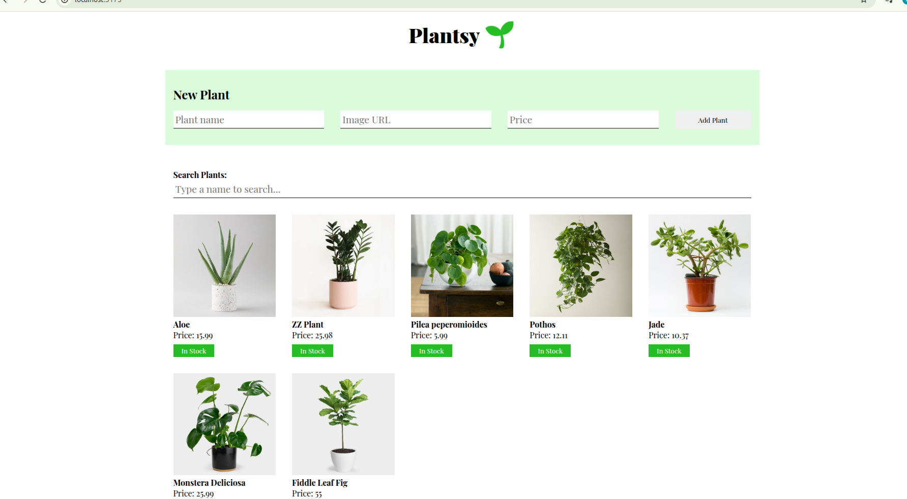

# Plantsy

A React application for a plant shop. It connects to a JSON server backend so users can browse plants, add new ones, mark plants as sold out, and search by name.

## Screenshot



## Features

- **View all plants:** every plant loads from the backend when the page opens.
- **Add a plant:** fill in the name, image URL, and price, then submit. The plant is saved to the backend and appears on the page.
- **Mark as sold out:** click the stock button on a plant card to toggle between "In Stock" and "Out of Stock". This is not saved to the backend, so it resets on refresh.
- **Search:** type in the search box to filter plants by name. Clearing the box shows all plants again.

## How It Works

| Feature | Event | Request | State update |
|---|---|---|---|
| View plants | Page loads | `GET /plants` | Set `plants` to the response |
| Add a plant | Form submit | `POST /plants` | Append the new plant |
| Sold out | Button click | None | Toggle `inStock` in the card |
| Search | Typing | None | Update `searchTerm` and filter the list |

## Component Structure

- `App`: renders the header and the plant page.
- `Header`: displays the app title.
- `PlantPage`: holds the `plants` and `searchTerm` state, fetches plants, and filters them.
- `NewPlantForm`: controlled form that sends the POST request.
- `Search`: controlled search input.
- `PlantList`: renders a `PlantCard` for each plant.
- `PlantCard`: displays one plant and tracks its own stock status.

## Getting Started

### Prerequisites

- [Node.js](https://nodejs.org/) and npm

### Installation

```bash
git clone <your-repository-url>
cd <repository-folder>
npm install
```

### Running the App

Start the backend (runs on `http://localhost:6001`):

```bash
npm run server
```

In a second terminal, start the React app:

```bash
npm run dev
```

Then open the local URL shown in the terminal.

### Running the Tests

```bash
npm run test
```

## Tech Stack

- React
- JSON Server
- Vitest / React Testing Library

## Author
Anita